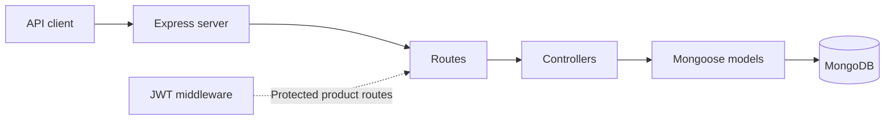

# Collaborative Marketplace API

REST API for a collaborative marketplace. Built with Node.js, Express and MongoDB to manage users, product listings and product reviews.

**Status:** Development project. Intended for local development and learning; not production-ready.

## Features

- User registration and login with JWT authentication and bcrypt password hashing.
- Product catalog with prices, stock, categories and image URLs.
- Product creation, editing and deletion routes.
- Product reviews and average rating calculation.
- User management endpoints.
- Request rate limiting, response compression and centralized error middleware.

## Tech stack

Node.js · Express · MongoDB · Mongoose · JWT · bcryptjs · Joi

## Architecture



The application separates routing, business logic, middleware and database models.

```text
marketplace-colaborativo/
├── config/          # MongoDB connection
├── controllers/     # User and product operations
├── middleware/      # Authentication and error handling
├── models/          # Mongoose schemas
├── routes/          # API endpoints
├── server.js       # Express entry point
└── package.json
```

## Getting started

Requirements: Node.js, npm and a MongoDB instance for local development.

```bash
git clone https://github.com/BlackCoffeeIA/marketplace-colaborativo.git
cd marketplace-colaborativo
npm ci
```

Configure a local `.env` file with your own development values. Never commit real credentials.

```dotenv
PORT=5000
MONGO_URI=mongodb://127.0.0.1:27017/marketplace
JWT_SECRET=replace_with_a_unique_local_development_secret
```

Run the development server:

```bash
npm run dev
```

The API uses port 5000 by default. To start without Nodemon, use `npm start`.

## API reference

Base URL: `http://localhost:5000/api`

### Products

| Method | Endpoint | JWT required |
| --- | --- | --- |
| GET | /products | No |
| GET | /products/:id | No |
| GET | /products/:id/reviews | No |
| POST | /products | Yes |
| PUT | /products/:id | Yes |
| DELETE | /products/:id | Yes |
| POST | /products/:id/reviews | Yes |

Protected requests use the `Authorization: Bearer <token>` header.

### Users

| Method | Endpoint |
| --- | --- |
| POST | /users/register |
| POST | /users/login |
| GET | /users |
| GET | /users/:id |
| PUT | /users/:id |
| DELETE | /users/:id |

User management routes still require authorization hardening. Use this project only with disposable local test data.

### Example: list products

```bash
curl http://localhost:5000/api/products
```

Example response for an empty catalog:

```json
{
  "success": true,
  "data": [],
  "message": "Productos obtenidos correctamente"
}
```

## Next steps

- Harden authentication, authorization and sensitive data handling.
- Apply consistent request validation and error responses.
- Review compatibility with the installed Mongoose version.
- Add automated API tests and pagination.
- Improve environment configuration and secret management.

The current repository has no automated test suite or frontend application.

---

[BlackCoffeeIA](https://github.com/BlackCoffeeIA)
