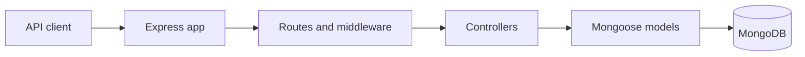

# Collaborative Marketplace API

A REST API for a marketplace where users can publish products and leave reviews. This backend project uses Node.js, Express and MongoDB.

## Features

- Account registration and login with hashed passwords and JWTs.
- Product catalog with pagination, prices, inventory and categories.
- Authenticated product creation and owner-only updates/deletion.
- Product reviews with rating validation and average ratings.
- Self-service account management, without a public user directory.
- Request validation, rate limiting and consistent error handling.

## Tech stack

Node.js · Express · MongoDB · Mongoose · JWT · bcryptjs · Joi

## Architecture



```text
config/        Database connection
controllers/   User and product operations
middleware/    Authentication, validation and errors
models/        Database schemas
routes/        REST API endpoints
test/          HTTP regression tests
app.js         Express application factory
server.js      Startup and database initialization
```

## Local setup

Requirements: Node.js 22 or newer, npm and a local MongoDB instance.

```bash
git clone https://github.com/BlackCoffeeIA/marketplace-colaborativo.git
cd marketplace-colaborativo
npm ci
cp .env.example .env
node -e "console.log(require('node:crypto').randomBytes(32).toString('hex'))"
```

On PowerShell, use `Copy-Item .env.example .env` instead of `cp` if needed. Put the generated secret in your local `JWT_SECRET` field. Configure `MONGO_URI` for your database; do not use production data in local development.

```bash
npm run dev
```

The server defaults to port 5000. Use `npm start` without Nodemon.

## API

Base URL: `http://localhost:5000/api`. Authenticated requests use `Authorization: Bearer <token>`.

| Method | Endpoint | Access |
| --- | --- | --- |
| POST | /users/register | Public |
| POST | /users/login | Public |
| GET | /users/:id | Account owner |
| PUT | /users/:id | Account owner |
| DELETE | /users/:id | Account owner |
| GET | /products?page=1&limit=20 | Public |
| GET | /products/:id | Public |
| POST | /products | Authenticated |
| PUT | /products/:id | Product owner |
| DELETE | /products/:id | Product owner |
| GET | /products/:id/reviews | Public |
| POST | /products/:id/reviews | Authenticated |

The former global user listing endpoint is intentionally denied. Account updates accept name and email only. Product updates accept partial fields. Account deletion is blocked while the account has listed products.

### Example

```bash
curl http://localhost:5000/api/products
```

```json
{
  "success": true,
  "data": [],
  "message": "Productos obtenidos correctamente",
  "pagination": { "page": 1, "limit": 20, "total": 0 }
}
```

## Testing

```bash
npm test
```

The Node.js test runner starts the HTTP application with mocked database methods. The suite checks authentication, account and product ownership, private fields and invalid input. A live MongoDB integration suite is still needed.

## Status

Development portfolio project, not a production service. Before deployment, verify real database behavior, audit dependency versions, add integration tests and review data retention, account deletion consistency, token revocation and operational controls.

---

[BlackCoffeeIA](https://github.com/BlackCoffeeIA)
